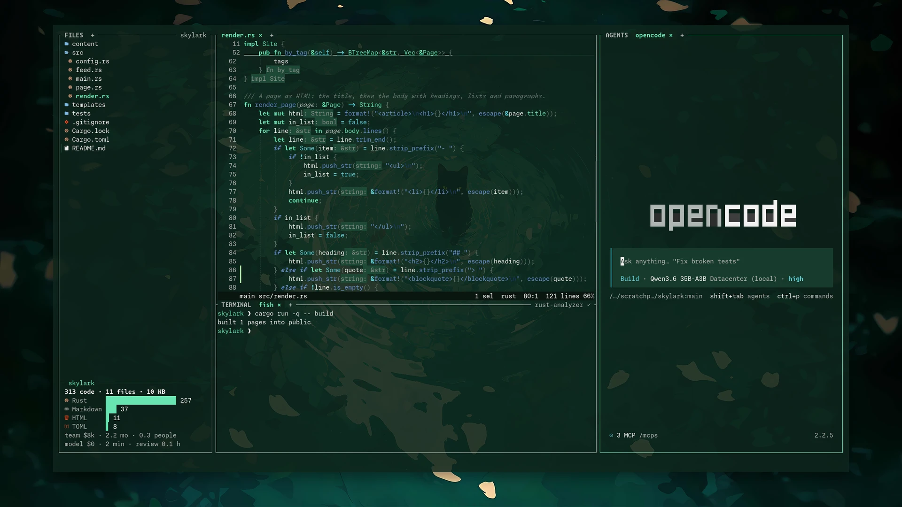
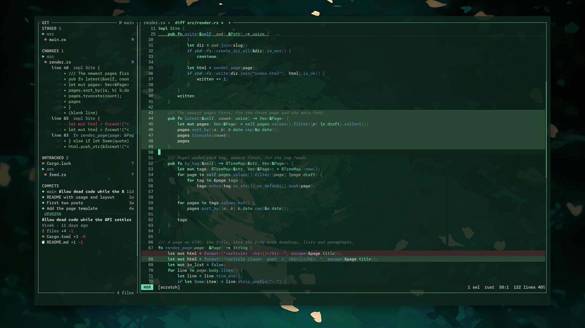
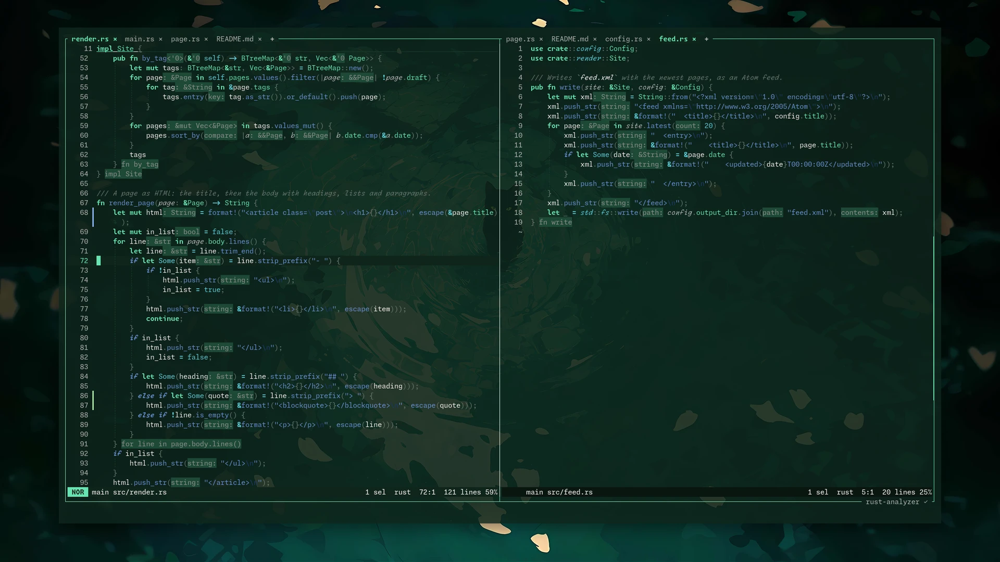
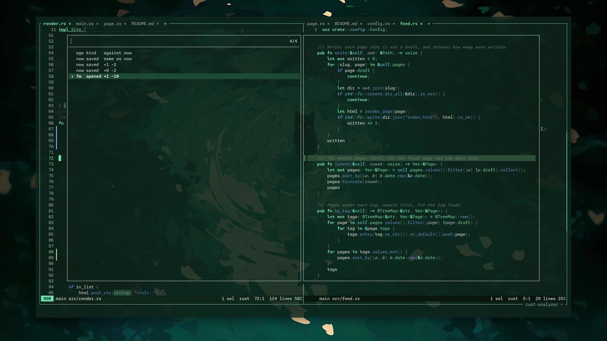
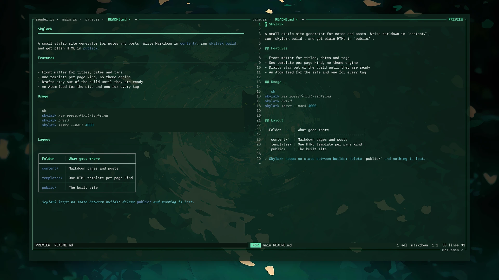

# Helide

Helix, with the rest of the workspace built in: a file tree, a git panel, terminals and AI
agents around the editor, in one terminal window.



Helide is a fork of [Helix](https://github.com/helix-editor/helix) 25.07. Everything Helix does
still works the same way; Helide adds panels and keeps out of the editing model. I wanted to stop
switching between an editor, a git client, a terminal multiplexer and an agent window, without
moving to a GUI editor.

## What it adds

**Panels**, each toggled with one key and resized by dragging its edge:

| Key | Panel |
|---|---|
| Ctrl+1 | File tree, with code stats for the folder you are in |
| Ctrl+2 | Git panel: stage, commit, branches, stashes, commit history |
| Ctrl+4 | Terminal, with tabs and side-by-side panes |
| Ctrl+5 | Agents: Claude Code or OpenCode in tabs |
| F11 or Space z | Zen: hide every panel |

**Git.** Changes, staged files and untracked files with their hunks, and a commit graph with a
summary of the selected commit underneath. A click opens a file's diff as a tab, tinted green
and red; a double click lists its hunks; a right click opens the file. Space stages, x
discards, c commits, m writes a commit message with a model.



**Tabs per split.** Each side-by-side split has its own row of file tabs. Drag a tab along the
row to reorder it, onto another split's row to move it there, or onto the terminal or an agent
to type its path. Double-click a tab to rename or move the file.



**Agents.** Claude Code and OpenCode run in the agent panel and come back on the same
conversation when you reopen the project. Claude Code connects through the same protocol its
VS Code extension uses, so it sees your selection and proposes edits as diffs. Space @ mentions
the current file and selection in the agent. A tab shows ● while the agent works and ✓ when it
finished while you were elsewhere.

**Time travel.** Helide keeps a private copy of every file you open and save. `:history` lists
the versions with a preview tinted against the file as it is now, and Enter puts one back (u
undoes it). `:history git` does the same through the commits that changed the file.



**Markdown preview.** Space m, or PREVIEW on the border, renders the Markdown file beside it,
with tables, code blocks and quotes.



**Smaller things**

- Sticky headers: the classes and functions you are scrolled into stay pinned at the top.
  Markdown headings too.
- The workspace (tabs, splits, panels, terminal and agent tabs) is saved per project and
  restored by `hx`, `hx .` or `hx folder/`. `hx file` opens just the file, for a quick edit.
- Open files reload when they change on disk; the tree and git panel update as files change.
- `:rewrite` and `:ask` use the local model from your OpenCode config; `:ask` can search the web
  through SearXNG.
- `hx msg` talks to a running editor over a socket: open files, run commands, type keys.

## Install

**From a release.** Download the tarball from
[Releases](https://github.com/ujjwalvivek/helide-rs/releases), unpack it anywhere and run the
`hx` inside. It finds the `runtime` folder next to it. Linux x86_64 only for now.

```sh
tar xf helide-v0.1.0-x86_64-linux.tar.xz
./helide-v0.1.0-x86_64-linux/hx .
```

**From source**, with Rust installed:

```sh
git clone https://github.com/ujjwalvivek/helide-rs
cd helide-rs
cargo install --path helix-term --locked
ln -Ts "$PWD/runtime" ~/.config/helix/runtime
hx --grammar fetch && hx --grammar build
```

Helide reads your Helix config in `~/.config/helix`. A Nerd Font makes the file icons show.

The agent panel needs `claude` or `opencode` on your PATH. The code stats need
[scc](https://github.com/boyter/scc).

In Ghostty, [contrib/ghostty/glow.glsl](contrib/ghostty/glow.glsl) gives text a soft glow, as in my editor Nib:
set it as `custom-shader` in Ghostty's config.

## Branches and versions

- `helide` is the main branch. Every change is tagged: v0.1.0, v0.1.1 and so on.
- `helide-rs-mozilla` is the same editor with [Otari](https://otari.ai) routing for the model
  commands, built for the Mozilla Otari hackathon. Its tags end in `-otari`.
- `master` mirrors upstream Helix, to merge from.

## How it was built

Built with Claude Code from late October 2026: I decided what each part should do and tested
every change on screen, Claude wrote most of the code. If you try it, I would like to know what
breaks first: [open an issue](https://github.com/ujjwalvivek/helide-rs/issues).

Helide is licensed under the MPL 2.0, like Helix. For Helix itself, its documentation and its
community, see [helix-editor.com](https://helix-editor.com).
